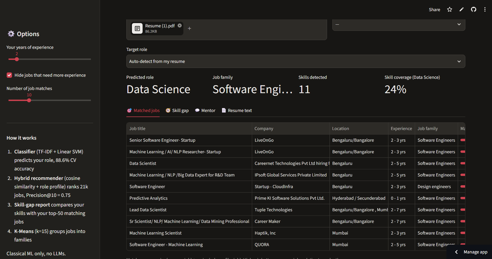
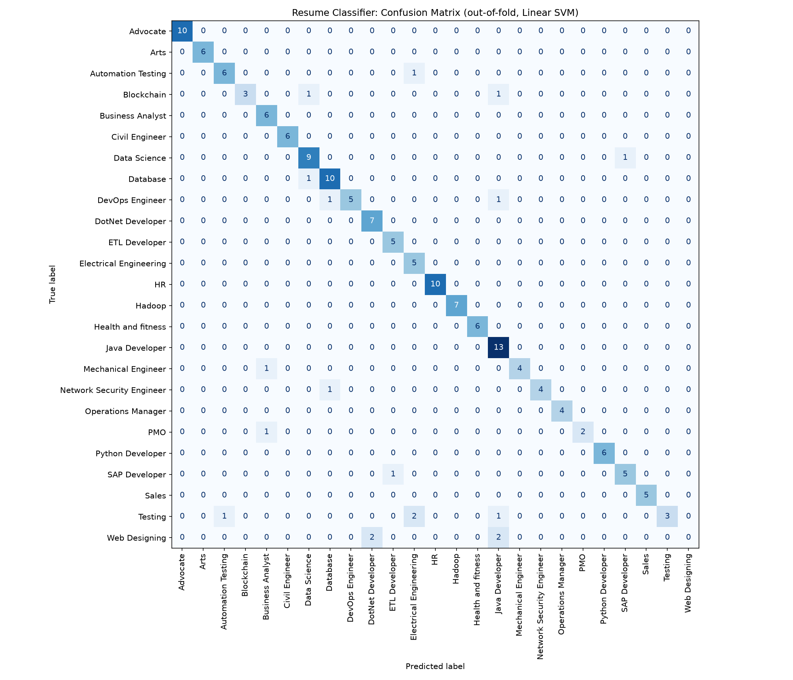
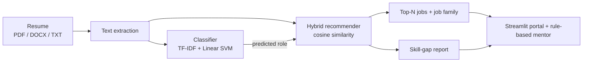

# 🎯 SmartHire — Resume-to-Job Matching & Career Guidance Engine

**🔗 Live demo: [smarthire-aristo.streamlit.app](https://smarthire-aristo.streamlit.app/)**

Upload a resume and SmartHire returns: (1) the predicted job role, (2) a ranked list of matching jobs
from 21,344 real Indian job postings, (3) a personalized skill-gap report, and (4) a rule-based career mentor.
Built entirely with **classical machine learning** (no LLMs / generative AI).



---

##  Features
| Feature | ML technique | Type |
|---|---|---|
| Resume role prediction (25 categories) | TF-IDF + Linear SVM | Supervised |
| Job recommendation (top-N ranking) | Hybrid cosine similarity (resume + role profile) | Unsupervised |
| Skill-gap report & role-fit score | Skill extraction + demand analysis of top-50 matched jobs | Rule-based on ML output |
| Job-family discovery | LSA (Truncated SVD) + K-Means, k = 15 | Unsupervised |
| Career mentor | Intent rules over model outputs | Rule-based (stretch goal) |

---

##  Results

### Resume classifier — 3-fold stratified cross-validation (166 unique resumes, 25 classes)
| Model | Accuracy | Macro F1 |
|---|---|---|
| **Linear SVM** | **0.886 ± 0.033** | **0.844** |
| Logistic Regression | 0.844 | 0.781 |
| Random Forest | 0.771 | 0.707 |
| Naive Bayes | 0.699 | 0.617 |

### Job recommender — Precision@10 over all 166 resumes (leakage-free)
| Version | Precision@10 |
|---|---|
| Random recommendations | 0.022 |
| TF-IDF + cosine similarity | 0.677 |
| **Hybrid (+ role profile from classifier)** | **0.749** |

### Job clustering
k = 15 chosen for interpretability (silhouette = 0.067; no natural elbow, as is typical for overlapping text data).



---

##  Key findings
1. **Data leakage in the resume dataset.** 796 of 962 resumes (83%) are exact duplicates. With a naive random split,
   99% of test resumes also appear in training and accuracy is a misleading **100%**. After de-duplication and
   cross-validation the honest accuracy is **88.6%**.
2. **Mislabeled column.** The job dataset's `skills` column actually contains the *functional area* (e.g. "ITES", "Legal"),
   so a custom **133-skill extractor** (regex, whole-word matching) was built.
3. **Template words dominate short resumes.** Words like "Education Details", "January" and "School" made an HR
   resume match school-teacher jobs. Domain stop words fixed this (0/5 → 3/5 HR jobs in the top 5).
4. **Supervised + unsupervised working together.** Feeding the classifier's predicted role into the recommender
   (hybrid score) raised Precision@10 from 0.677 to 0.749.

---

##  Architecture


---

##  Project structure
```text
smarthire/
├── app/streamlit_app.py        # web portal (UI only)
├── src/
│   ├── config.py               # paths & constants
│   ├── pipeline.py             # SmartHire engine used by the app
│   ├── mentor.py               # rule-based career mentor
│   ├── evaluate.py             # Precision@K evaluation
│   ├── data/preprocess.py      # cleaning & de-duplication
│   ├── features/               # TF-IDF + skill extraction
│   ├── models/                 # classifier, recommender, skill gap, clustering
│   └── parsing/resume_parser.py
├── notebooks/                  # 01 EDA → 02 classifier → 03 recommender → 04 clustering
├── tests/                      # pytest unit tests
└── reports/figures/            # all plots
```

---

##  Run locally
```bash
git clone https://github.com/Aristo03/SmartHire.git
cd SmartHire
python -m venv .venv
.venv\Scripts\activate          # Windows  (macOS/Linux: source .venv/bin/activate)
pip install -r requirements-dev.txt
streamlit run app/streamlit_app.py
```
Run tests: `python -m pytest -v`

To re-run the notebooks, download the two Kaggle datasets below into `data/raw/`.

---

##  Limitations
- **Small resume dataset**: only 166 unique resumes (3–13 per class); Web Designing is often confused with Java Developer.
- **Dated job corpus** (Naukri, ~2016–17): e.g. only 1 blockchain job exists, so blockchain recommendations are impossible.
- **Weak evaluation labels**: Precision@K uses job-title keywords as approximate relevance labels.
- **Vocabulary-based skills**: skills outside the 133-skill vocabulary (or written differently) are not detected.
- **No OCR**: scanned (image-only) PDF resumes cannot be read.

##  Future work
Sentence embeddings for semantic matching · learning-to-rank · larger/more recent job data · OCR support.

---

##  Datasets
- *Resume Dataset* (`UpdatedResumeDataSet.csv`): Kaggle
- *Naukri.com job postings* (`naukri_com-job_sample.csv`): Kaggle

## 👤 Author
**Aristo Don Annuncio** · [LinkedIn] https://www.linkedin.com/in/aristodonannuncio/ · Built as part of an ML internship project.